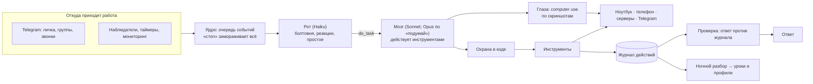

# Jarvis

Личный ИИ-агент, который живёт на сервере круглые сутки, пишет в Telegram со своего аккаунта как обычный человек и управляет
устройствами владельца: ноутбуком, телефоном на Android и другими серверами.

Он решает сам и спрашивает только про деньги, удаление важного и первое сообщение незнакомым. Каждое «сделал» подтверждается
журналом того, что реально произошло. Не умеет что-то сделать: ищет в интернете, пробует и запоминает как навык. Учится на
поправках владельца и на том, как говорят в его чатах.

> Это личный проект, не продукт: код написан под одного владельца и его инфраструктуру. Читайте как пример устройства
> агента с «руками» и контролем. Подробная инструкция по установке и эксплуатации: [README_JARVIS4.md](README_JARVIS4.md).

## Что он умеет

| | |
| --- | --- |
| **Общение** | Личка, группы и звонки в Telegram со своего аккаунта (не бота). Отвечает коротко, как человек: реакции, много стикеров и гифок (каждую перед отправкой проверяет на уместность), словечки чата и свой словарь. На серьёзный вопрос «ты бот?» не отрицает, что он ИИ. |
| **Свой Telegram** | Всё, что делает человек: вступить и выйти, заблокировать, игнорить, создать и удалить канал или группу, постить, модерировать группу (кик, бан, мут, админы, закреп), сменить профиль. |
| **Для всех** | Видео и фото по ссылке из TikTok, Instagram, Pinterest, YouTube и других сайтов (голая ссылка — сразу файл в ответ, без ИИ); модерация по просьбе админов группы. |
| **Дела на ноутбуке** | Открывает программы (из меню «Пуск» и приложений Windows, а не просто то, что нашлось в PATH), закрывает окна, печатает, управляет плеером и проверяет, что звук идёт на самом деле. |
| **Глаза и руки** | Смотрит на скриншот и нажимает мышью и клавишами через [computer use](https://platform.claude.com/docs/en/agents-and-tools/tool-use/computer-use-tool) Anthropic. Так же работает с экраном телефона. |
| **Телефон** | Android по ADB через Tailscale: экран, уведомления, приложения, состояние. |
| **Серверы** | Своя машина (команды, скрипты, фоновые задачи, бекапы) и другие серверы по SSH, у каждого свои права: «только смотреть состояние» или полный доступ. |
| **Круглосуточное дежурство** | Мониторинг сайтов и серверов без ИИ; вход чужим ключом на сервер поднимает тревогу: звонки в Telegram, пока владелец не ответит, затем SMS и звонок робота на телефон. Напоминания, наблюдатели («скажи, когда…»). |
| **Учёба** | Навыки, уроки из поправок, словечки и стикеры каждого чата, свой словарь сленга (незнакомые слова спрашивает у людей), ночной разбор дня ([ниже](#как-он-учится)). |

## Как это устроено



- **Рот и мозг.** Быстрая дешёвая модель отвечает в чате сразу и делает простое сама. Всё, что требует устройств или многих
  шагов, она передаёт мозгу, а он работает на самой дешёвой подходящей модели и поднимается выше только после двух неудач
  подряд.
- **Охрана и журнал вне модели.** Правила живут в коде, поэтому модель не может их «забыть». Каждое действие проходит охрану,
  попадает в журнал, а ответ перед отправкой сверяется с журналом: что в нём не подтверждено, переписывается по фактам.
- **«Стоп».** Слово «стоп» работает без модели: отменяет задачу, очищает очередь и на 10 минут замораживает наблюдателей.

### Охрана

| Класс | Примеры | Что делает |
| --- | --- | --- |
| Читать | экран, чаты, файлы, мониторинг, интернет | сам |
| Своё | программы, файлы, настройки, музыка на своих машинах | сам, пишет в журнал |
| Наружу | написать или позвонить тому, кого владелец назвал | сам, с паузами |
| Красный список | деньги, удаление важного, писать первым незнакомым, менять свой код, запуск скрипта из интернета, выключение машины | один вопрос владельцу на весь план |
| Никогда | читать или выносить `.env` и сессию Telegram, второй клиент на одной сессии, отключать свой доступ | отказ |

### Деньги

Лимит по умолчанию **$2 в день** (считается по часам владельца). Лестница: без ИИ и бесплатный Gemini (видео, гифки, голос
звонков) → Haiku (болтовня, простое) → Sonnet (новые задачи, экран) → Opus только по слову «подумай». После $1.50 отвечает
только Haiku, после $2 остаётся небольшой резерв владельцу. Лимит на одну задачу $0.40, на экранную $0.50, чужие и группы
вместе $0.40 в день. Команда `/limit` сбрасывает счёт или поднимает лимит на сегодня.

## Как он учится

- **Навыки.** Новое дело решает Sonnet; не знает как, ищет в интернете и пробует. Получилось, и он сохраняет навык
  (только после реальной удачной работы). Навык растёт: черновик → проверен (сработал ещё раз) → надёжный (три раза) и
  становится «сломан», если сбоев больше удач. Владелец может показать сам: «смотри, как я делаю» записывает его клики.
- **Уроки.** Каждая поправка («я же сказал звонить, а не писать») становится уроком и сразу попадает в промпт.
- **Окружение.** Слова и стикеры каждого чата считаются кодом бесплатно, и он говорит словечками этого чата.
- **Ночной разбор.** После 4 утра один вызов модели разбирает день: сбои и поправки превращаются в новые уроки, обновляются
  профили людей. Тихий день не стоит ничего. Утром приходит короткая записка, что выучил (`/unlesson N` забывает урок).

## Экзамен

Агент проверяется на сценариях из его собственных реальных провалов: стикер ответом на записку, звонок вместо сообщения,
«открой клауд» без терминала, «стоп» посреди задачи, цифры только из мониторинга, «ты бот?» и другие. Сценарии запускаются в
придуманном мире (люди, чаты, окна, сервер), и результат проверяют код и судья-модель. У каждого сценария есть эталонное
решение, а агент, который отвечает «Готово» и ничего не делает, обязан завалить почти все.

```sh
python -m unittest discover -s jarvis4/tests -t .            # 152 теста кода, без денег и сети
python -m jarvis4.exam --agent scripted:reference            # эталон должен сдать всё (бесплатно)
python -m jarvis4.exam --agent jarvis4 --repeat 3            # настоящие модели, ~$0.15, нужен ключ
```

Каждый новый провал из жизни становится новым сценарием.

## Структура репозитория

| Путь | Что там |
| --- | --- |
| `jarvis4/` | Jarvis 4: ядро (`core.py`, `agent.py`, `guard.py`, `budget.py`, `store.py`, `verify.py`, `eyes.py`, `learn.py`), `tools/` (то, что агент умеет), `nodes/` (ноутбук, Android, SSH, сервер), `tg/` (аккаунт, звонки, стикеры), `ops/` (мониторинг, SMS, голос, интернет), `exam/` (мир, сценарии, судья), `tests/` |
| `hands.py`, `core/probe.py` | Ноутбучная часть: исполнитель команд сервера, поиск программ, окна, звук, скриншоты, мышь и клавиатура |
| `deploy/` | Служба systemd, загрузка кода, переключение с прошлой версии и откат |
| `core/` | Что `hands.py` делает на ноутбуке: окна, клавиатура и мышь, дерево UI Automation, рутины, связь с сервером |
| `tests/` | Тесты ноутбучной части (запускаются на Windows) |
| `requirements-server.txt`, `requirements-laptop.txt`, `.env.example` | Зависимости сервера и ноутбука, образец настроек |

## Быстрый старт

Нужно: сервер с Linux и systemd, Python 3.14, ключ Anthropic, **отдельный** аккаунт Telegram (не личный) и `api_id`/`api_hash`
с [my.telegram.org](https://my.telegram.org). Необязательно: ключ Gemini (видео, гифки, голос звонков), SMSC (SMS и звонок
робота), Tailscale (связь с ноутбуком и телефоном).

1. На сервере создать каталог `/opt/jarvis` (владелец: пользователь службы) и в нём `backup/`; поставить системные пакеты
   `ffmpeg` (а для телефона `adb`).
2. С вашего компьютера отправить код: `JARVIS_HOST=пользователь@сервер sh deploy/push.sh` (копирует `jarvis4/`, `deploy/` и
   `requirements-server.txt` в `/opt/jarvis`).
3. На сервере: `cd /opt/jarvis && python -m venv .venv && .venv/bin/pip install -r requirements-server.txt`.
4. В `/opt/jarvis/.env` задать `ANTHROPIC_API_KEY`, `OWNER_TG_ID` (ваш числовой Telegram-ID), `TG_API_ID`, `TG_API_HASH`,
   `HANDS_TOKEN` (любая длинная случайная строка; остальное в [README_JARVIS4.md](README_JARVIS4.md)).
5. Один раз войти в Telegram-аккаунт агента:
   `cd /opt/jarvis && set -a && . ./.env && set +a && .venv/bin/python -m jarvis4.login`. Код из Telegram вводите сами, сессия
   остаётся только на сервере.
6. Поставить службу: `sudo cp deploy/jarvis4.service /etc/systemd/system/ && sudo systemctl daemon-reload &&
   sudo systemctl enable --now jarvis4`. Логи: `journalctl -u jarvis4 -f`.
7. По желанию ноутбук: `pip install -r requirements-laptop.txt`, затем запустить `hands.py`. Он подключается к серверу через
   SSH-туннель, адреса задаются в `.env` ноутбука (`JARVIS_HANDS_TOKEN` тот же, что `HANDS_TOKEN`, а также `JARVIS_SSH` и
   `JARVIS_HUB`; образец в `.env.example`).

Телефон на Android и другие серверы подключаются отдельно, шаги в [README_JARVIS4.md](README_JARVIS4.md).

### Команды владельцу

Работают без модели и бесплатно: `/stop`, `/reset`, `/cost`, `/limit`, `/status`, `/monitor`, `/screen`, `/memory`, `/lessons`,
`/unlesson N`, `/watchers`, `/unwatch N`, `/groups`, `/group N тихо|говори|выкл`, `/voice`, `/calltest`, `/phonetest`.

## Состояние проекта

Работает на сервере с 26 октября 2026. Что проверено:

- Экзамен на реальных моделях: 41 из 48 прогонов (16 сценариев по три раза) в первом честном прогоне. Позже добавлен 17-й
  сценарий и исправлены найденные ошибки; повторный полный прогон ещё предстоит.
- Цикл «глаз» на реальной модели, поиск и запуск программ, скриншот и окна на реальном ноутбуке, связка сервера с ноутбуком,
  узлы сервера (команды, интернет, мониторинг).

Что ещё не проверено на живых людях и устройствах: разговоры в настоящем Telegram, звонки, телефон по ADB (написан и покрыт
тестами на поддельном `adb`, к настоящему телефону не подключался), SSH на другие серверы, ночной разбор и спонтанные реплики
в группах. Это первое, что нужно смотреть в `journalctl -u jarvis4` в первые дни.

## Безопасность и приватность

Агент действует от имени владельца: пишет и звонит со своего аккаунта, управляет его машинами и видит всё, что приходит на
этот аккаунт, поэтому проект рассчитан на одного владельца и на сервер, которым он управляет. Секреты (`.env`, сессия Telegram) лежат только на сервере и недоступны агенту как данные. Пароли и платёжные данные
он не вводит. Текст из окон, сайтов и сообщений чужих людей считается данными, а не командами; приказывает ему только владелец.
В репозиторий не должны попадать ключи, сессии и личные данные.
